<p align="center"></p>

<h1 align="center">NTE Omikuji</h1>

Windows 桌面工具。從遊戲的網路封包讀取《異環》（Neverness to Everness）的抽卡紀錄，統計保底和運氣，並可匯出 JSON、CSV 和分享圖。

非官方粉絲專案，與遊戲開發商無關。只讀取封包，不修改遊戲，紀錄都留在你的電腦。只有按下自動翻頁時，才會對遊戲送出翻頁操作。

README 裡的畫面都使用模擬資料。

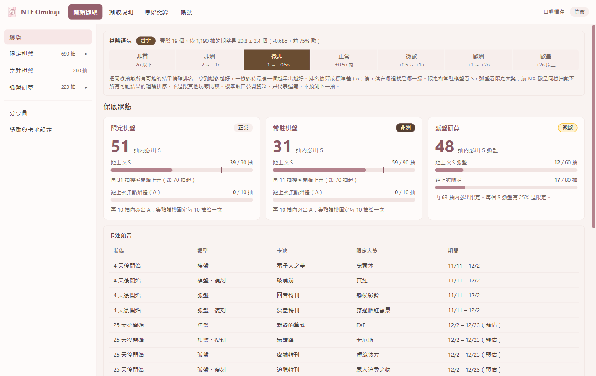

## 功能

- **沒有人維護也能繼續用**：遊戲更新後，獎勵名稱、稀有度和每期限定大獎都能在介面裡自己補上，不用等程式更新，詳見[下方說明](#沒有人維護也能繼續用)
- 擷取限定棋盤、常駐棋盤、弧盤研募、盲盒的抽卡紀錄和成就
- 顯示三個卡池的保底進度和距離保底的抽數
- 用七個等級標示整體、每個卡池、每一期的運氣
- 把紀錄累積存檔，更新前自動備份
- 產生分享圖
- 匯出 JSON、CSV，也可匯入 NTE_Gacha_Exporter 的紀錄

## 使用方式

需要 64 位元 Windows 10 1809 以上。不用另外安裝 .NET 或 Npcap。WebView2 執行階段是 Windows 11 內建，Windows 10 通常也已安裝。

1. 把 `NteOmikuji.exe` 放在一個可寫入的資料夾，再執行。檔案約 94 MB，沒有數位簽章，SmartScreen 可能會警告。
2. 開啟 **開始擷取** 並按下按鈕。Windows 會要求系統管理員權限，因為讀取網路封包需要這個權限。如果已安裝 Npcap，就不會要求。
3. 在遊戲主選單按下開始之前就要開始擷取。
4. 在遊戲裡打開抽卡紀錄，從第 1 頁往下捲到底，或在 **開始擷取** 頁按 **自動翻頁** 的按鈕讓程式翻。每個卡池都要各做一次。
5. 資料會自動存到 exe 旁邊的 `user_data`，**總覽** 和卡池頁面會即時更新。

自動翻頁不用另外安裝，規則如下：

- 按下按鈕後切回遊戲。只有遊戲在前景時才會動作，切走就會停止。
- 程式會把訊息送給遊戲視窗，點「下一頁」。游標每次會跳到按鈕再跳回來，這段時間不要操作電腦。
- 每次點擊的不到 0.1 秒內，實體滑鼠會暫停，避免點偏。程式不會注入遊戲，也不會讀取遊戲記憶體。
- 按 Esc 或移動滑鼠就會停止。連續 3 次點擊都沒有收到新頁面，就視為翻完。
- 遊戲以系統管理員身分執行時，本程式也要提權才點得到。擷取方式選「內建擷取」就會提權。
- 支援限定棋盤、常駐棋盤和弧盤研募，遊戲視窗比例建議用 16:9。程式不會辨識畫面，所以請先確認遊戲停在正確的紀錄頁。

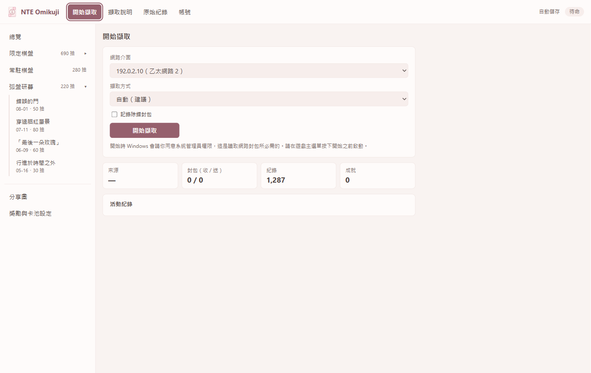

## 沒有人維護也能繼續用

這是本程式最重要的設計目標：**就算維護者不再更新，你也能自己把資料維護下去。** 程式不需要任何伺服器，所有資料都是你電腦上可以直接編輯的檔案。

遊戲更新後，大多數情況只要改資料，不用改程式：

| 遊戲更新了什麼 | 程式會怎樣 | 你要做什麼 |
| --- | --- | --- |
| 新獎勵 | 保留遊戲原字串，排在最上面並標示「未對應」 | 在 **獎勵與卡池設定** 填名稱、稀有度和關注類別 |
| 新活動、新限定大獎 | 標示「未設定」，受影響的卡池顯示「無法判定」 | 在 **活動卡池** 填這期的限定大獎 |
| 新語言 | 名稱依序改用英文、中文、其他語言 | 按 **新增語言**，再填名稱 |
| 新的卡池預告 | 總覽不會顯示 | 編輯 `mappings\schedule.csv` |

改動會立刻存檔，也會更正已存的紀錄。更多欄位說明見[獎勵與卡池設定](#獎勵與卡池設定)。

### 實際演示：遊戲推出新活動

以下用程式實際操作一次，以 1.5 版的曳爾沐和她的弧盤靜候彩鈴為例。紅框和「只顯示這兩列」都是為了說明才加上的。

> 撰寫時 1.5 版還沒開放，**抽卡紀錄是模擬的，`1090`、`fork_EchoesOnHold`、`Lottery_Elyms`、`ForkLottery_Elyms` 這些 ID 也是假設的**。實際操作時，請以程式列出來的 ID 為準。

**1. 先看哪裡不對**

重新擷取後，紀錄不會遺失，但曳爾沐還不算 S。畫面上方會提醒有活動沒設定，各期運氣顯示「無法判定」，距上次 S 也還在累加。

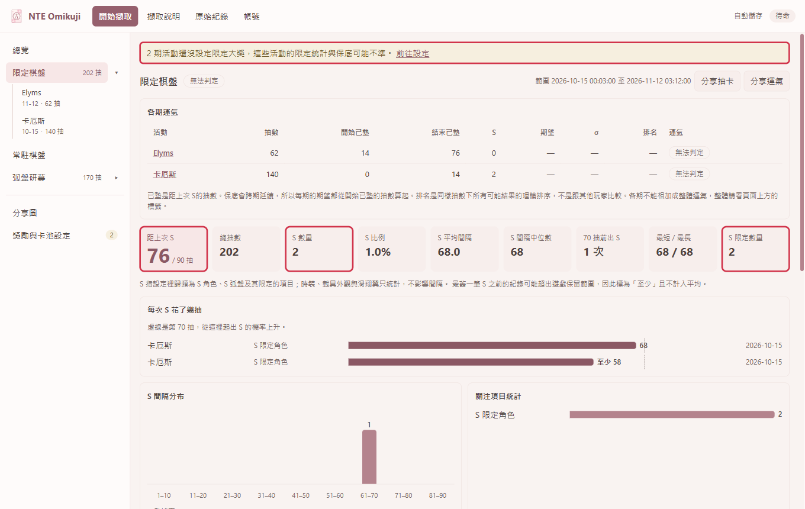

**2. 補上新獎勵**

按提醒裡的 **前往設定**，或開啟 **獎勵與卡池設定** 的 **獎勵** 分頁。沒有對應的獎勵會排在最上面，並標示「未對應」。

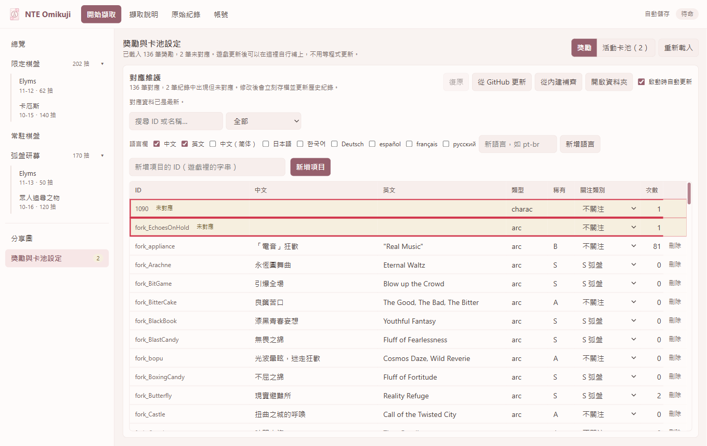

在該列直接填寫，改完就會存檔：

| 欄位 | `1090` 填 | `fork_EchoesOnHold` 填 | 從哪裡看 |
| --- | --- | --- | --- |
| 中文、英文 | 曳爾沐、Elyms | 靜候彩鈴、Echoes on Hold | 遊戲內的名稱 |
| 類型 | `character` | `arc` | 角色或弧盤 |
| 稀有 | `S` | `S` | 遊戲內的稀有度 |
| 關注類別 | 不用改 | 不用改 | 填好類型和稀有度後，會自動變成 S 角色、S 弧盤 |

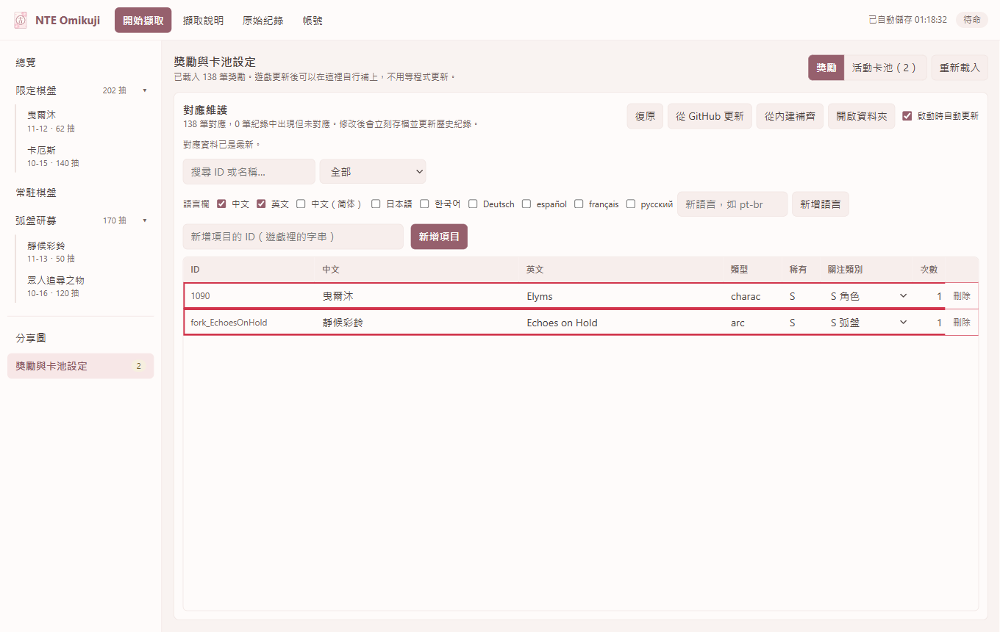

**3. 設定這期的限定大獎**

切到 **活動卡池** 分頁，紀錄裡出現的新活動會排在最上面，並標示「未設定」。活動 ID 不用自己找，程式會從紀錄帶入。

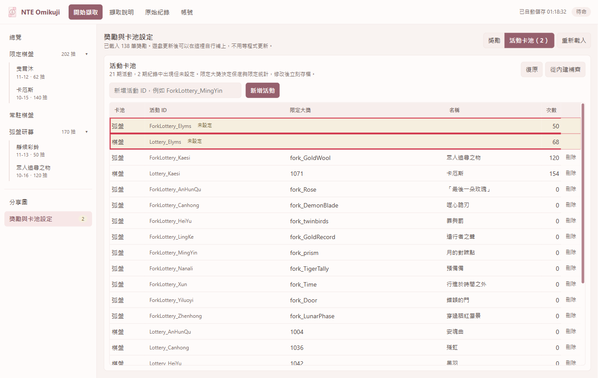

在 **限定大獎** 欄填這期主打獎勵的 ID。棋盤填 `1090`，弧盤填 `fork_EchoesOnHold`。有多個時用分號隔開，第一個會當作活動名稱。先做完第 2 步，名稱才會顯示出來；否則會顯示「對應表找不到」。

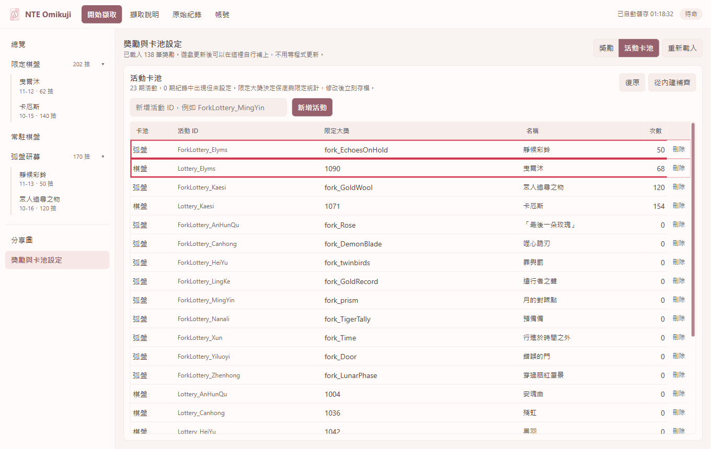

**4. 確認結果**

回到卡池頁，不用重新擷取，已存的紀錄會直接更正：

| 項目 | 修改前 | 修改後 |
| --- | --- | --- |
| S 數量 | 2 | 3 |
| 距上次 S | 76 | 28 |
| S 限定數量 | 2 | 3 |
| 這期的運氣 | 無法判定 | 正常（+0.47σ） |

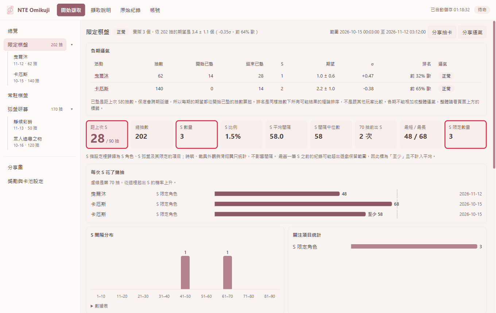

改錯了可以按 **復原**。以上改動都存在 `mappings` 資料夾，用 Excel 或文字編輯器直接改也可以：

```csv
# mappings\rewards.csv：id,type,rank,focus,name.zh-hant,name.en
1090,character,S,,曳爾沐,Elyms
fork_EchoesOnHold,arc,S,,靜候彩鈴,Echoes on Hold

# mappings\events.csv：id,featured
Lottery_Elyms,1090
ForkLottery_Elyms,fork_EchoesOnHold
```

上面的 `#` 開頭只是說明，不要寫進檔案。欄位順序以檔案第一行為準，少填的欄位留空。

`mappings\schedule.csv` 裡曳爾沐和靜候彩鈴的兩列（`1.5-1-board-elyms`、`1.5-1-arc-elyms`）已經有名稱和期間，只差 `event_id`。擷取到實際的活動 ID 後，可以順手填上。

### 把維護成果分享給別人

- `mappings` 資料夾裡的四個 CSV 就是全部的對應資料，複製給別人放到同一個資料夾就能用，Excel 也能開。
- 獎勵和成就對應也可以在 **原始紀錄** 的匯入分頁匯入，只會新增或更新檔案裡有的項目。
- 想接手維護的話，可以 fork 本專案並更新 `src/NteOmikuji.Core/Mappings` 裡的檔案。使用者在 `user_data\settings.json` 把 `MappingSource` 設成那個資料夾的 HTTPS 網址，**從 GitHub 更新** 就會改從那裡下載，例如：

```json
{ "MappingSource": "https://raw.githubusercontent.com/你的帳號/NTE_Omikuji/main/src/NteOmikuji.Core/Mappings/" }
```

更新來源不見時，只會顯示更新失敗，程式和你的資料都不受影響。

### 什麼情況一定要改程式

| 情況 | 影響 | 在等到新版之前 |
| --- | --- | --- |
| 封包格式大改 | 新紀錄可能抓不到，或標為未驗證 | 已存紀錄不會被蓋掉，仍可查看和匯出 |
| 機率或保底規則改變 | 運氣和保底計算可能不準 | 紀錄本身不受影響 |
| 紀錄頁按鈕位置改變 | 自動翻頁點不到 | 手動翻頁仍可擷取 |

這些規則都寫在原始碼裡，`src/NteOmikuji.Core` 可以自行修改和建置，建置方式見[開發](#開發)。

## 運氣怎麼算

### 等級

把同樣抽數下所有可能的結果做精確排名，再換算成標準差（σ）來分級。

| 等級 | 範圍 |
| --- | --- |
| 非酋 | −2σ 以下 |
| 非洲 | −2σ ～ −1σ |
| 微非 | −1σ ～ −0.5σ |
| 正常 | ±0.5σ 內 |
| 微歐 | +0.5σ ～ +1σ |
| 歐洲 | +1σ ～ +2σ |
| 歐皇 | +2σ 以上 |

- 棋盤看 S，弧盤只看限定大獎，一般 S 弧盤不計入。
- 拿到的數量越多，排名越前面。數量相同時，最後一個越早出越前面。
- 棋盤可以單抽，所以逐抽排名。弧盤只能十連，同一次十連內的位置視為同名次。
- 「前 N% 歐」是同抽數下所有可能結果的理論排序，不是和其他玩家比較。程式不會上傳資料，所以沒有玩家之間的比較。
- 整體運氣是把三個卡池的結果，依各自的期望數量加權合併。
- 顯示的 σ 由排名換算而來，不等於「實際數量和期望差幾個標準差」。抽卡數量的分布是偏斜的，直接相減在抽數少時會高估。
- 抽數很少時也會算出等級，但結果只靠很少的獎勵決定。例如棋盤 10 抽沒出 S 是正常，10 抽內出 S 至少是歐洲。

### 規則和機率

| 卡池 | 基礎機率 | 保底 |
| --- | --- | --- |
| 限定棋盤、常駐棋盤 | S 0.99%，超過 70 抽後 19.59% | 90 抽必出 S，每 10 抽有一次集點贈禮（A） |
| 弧盤研募 | S 3%，其中 25% 是限定 | 60 抽必出 S，80 抽必出限定，每 10 抽必出 A。出限定時，S 的保底也會重置 |

這些機率來自公開攻略和玩家提供的資料，不是官方公告。用這些規則算出的結果和公開數字相符：

| 項目 | 計算結果 | 公開或玩家提供 |
| --- | --- | --- |
| 棋盤每個 S 平均抽數 | 53.2 | 約 53.5 |
| 弧盤每個限定平均抽數 | 59.4 | 約 59.5 |
| 弧盤 S 含保底的綜合機率 | 4.20% | 4.19% |
| 弧盤限定含保底的綜合機率 | 1.68% | 1.68% |

### 每一期的運氣

卡池頁的「各期運氣」表列出每一期的結果。點活動名稱可以看該期的頁面。

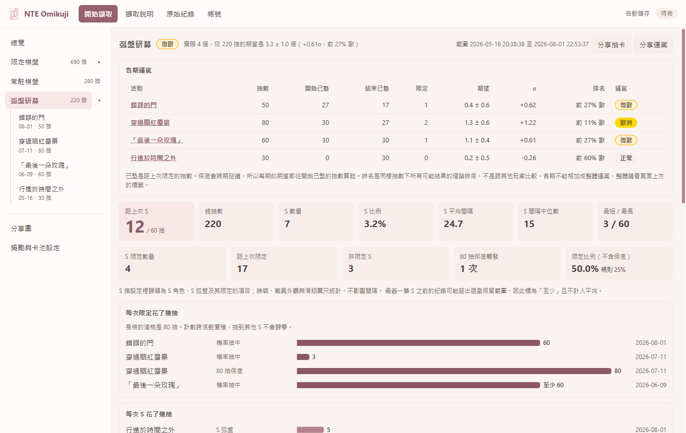

- **開始已墊**：這期開始時，距上次 S（弧盤是距上次限定）已經抽了幾抽。保底會跨期延續，所以期望值從這個抽數算起。
- **結束已墊**：這期結束時留給下一期的抽數。
- 各期的結果不能相加成整體運氣。
- 如果同一段時間交替抽兩個活動，該期結果是近似值。

### 其他統計規則

- 棋盤只有骰子結果算一抽，集點贈禮和沉眠地不算。
- 最舊的一筆 S 顯示為「至少 N」，不計入平均，因為遊戲只保留約半年的紀錄，更早的抽數可能不在紀錄內。
- 紀錄不完整或有活動還沒設定限定大獎時，標籤會顯示「無法判定」。
- 0.3.0 以前存的檔案，把很多抽誤判成集點贈禮。檔案裡沒有原始資料可以修正，程式會提示，重新擷取一次就會更正。
- 舊版在同一次擷取中抽完再看紀錄，可能讓十連少掉部分結果、其他結果重複。總抽數不變，但 S 可能不見。從第 1 頁重新看到底一次就會更正。

## 分享圖

在左側選單開啟 **分享圖**，或在卡池頁、活動頁按 **分享抽卡**、**分享運氣**。可以儲存 PNG 或複製到剪貼簿，有淺色的「櫻」和深色的「墨」兩種配色。

UID 預設不顯示。勾選後也只顯示遮蔽中段的版本，例如 `214*******56`。

| 範本 | 尺寸 | 內容 |
| --- | --- | --- |
| 總覽 | 1920×1080 | 整體運氣，三個卡池的保底和出貨歷程 |
| 運氣 | 1080×1080 | 運氣等級和在分布上的位置，可選整體、卡池或某一期 |
| 單池 | 寬 1080，高最多 1350 | 一個卡池或一期的數字和每次出貨的抽數 |

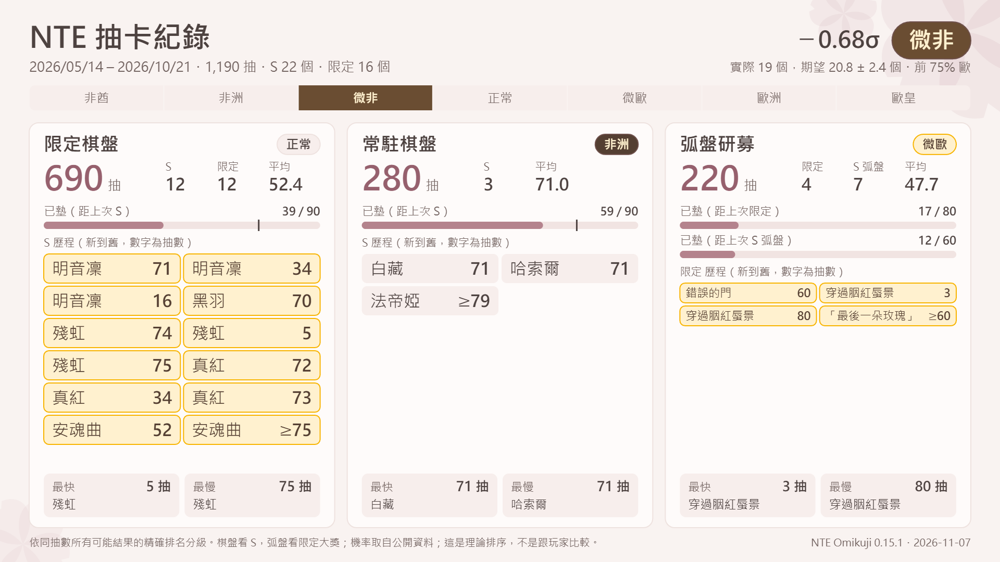

<p>
  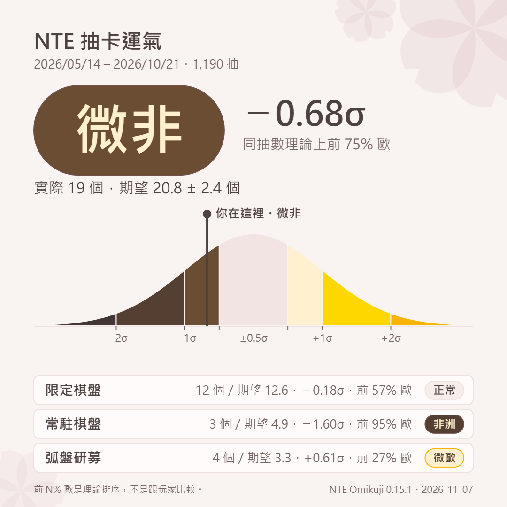
  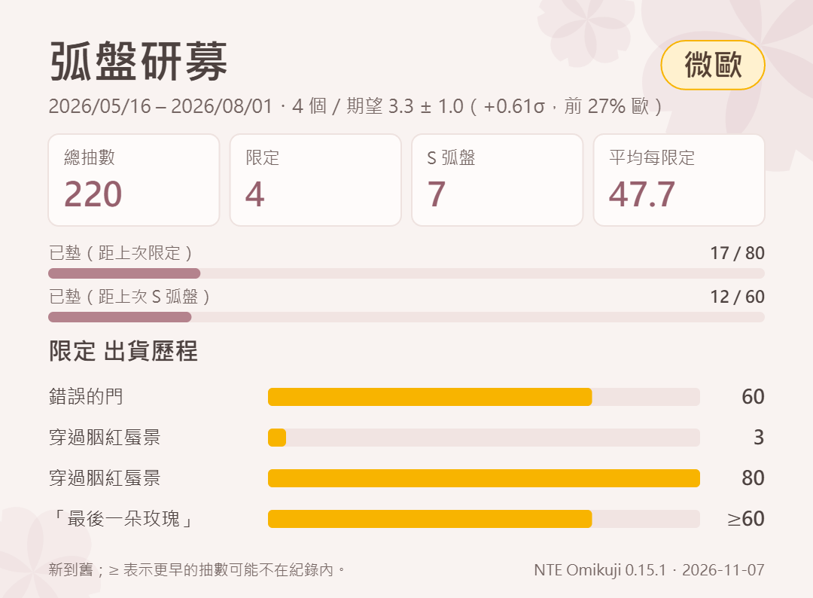
</p>

## 獎勵與卡池設定

在左側選單開啟 **獎勵與卡池設定**。每次修改會立刻存檔，也會更正已存的紀錄。

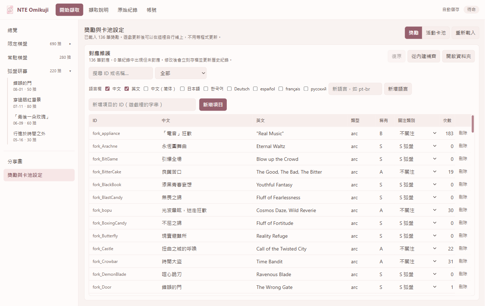

### 獎勵

- 紀錄裡出現但還沒有對應的獎勵，會排在最上面並標示「未對應」。填入任一欄就會建立資料。
- **新增語言**：輸入語言代碼，例如 `pt-br`。名稱缺少時依序改用英文、中文、其他語言。
- **復原**：復原這次開啟程式後做的修改。
- **從內建補齊**：補上內建資料裡有、但你的檔案缺少的列和空白欄位，不會改動已填的內容。
- **從 GitHub 更新**：下載本專案最新的 `rewards.csv`、`achievements.csv`、`events.csv`、`schedule.csv`，套用上游的新增和更正，可以用復原還原。你改過的欄位和刪掉的列都會保留。只下載，不會送出你的資料。預設每次啟動時自動更新一次，可以取消勾選 **啟動時自動更新**。

也可以直接編輯 `mappings\rewards.csv`，改動會反映到開著的程式。Excel 存成「CSV UTF-8」或一般「CSV」都可以，但 Excel 會鎖住檔案，在程式裡編輯前要先關閉。

| 欄位 | 說明 |
| --- | --- |
| `id` | 遊戲裡的獎勵字串，不分大小寫 |
| `type` | `character`、`arc`、`cosmetic`、`item` 或其他文字 |
| `rank` | `S`、`A`、`B` 或其他文字 |
| `focus` | 關注類別，填代碼或中文名稱，空白時自動判斷 |
| `name.<語言>` | 該語言的名稱，增加欄位就是增加語言 |

| 關注類別 | `focus` 代碼 | 統計方式 |
| --- | --- | --- |
| S 角色 | `s_character` | 算 S，重置間隔 |
| S 弧盤 | `s_arc` | 算 S，重置間隔 |
| S 限定角色 | `s_limited_character` | 算 S，也計入限定數量 |
| S 限定弧盤 | `s_limited_arc` | 算 S，也計入限定數量 |
| 時裝 | `outfit` | 只統計 |
| 載具外觀 | `vehicle_skin` | 只統計 |
| 滑翔翼 | `glider` | 只統計 |
| 不關注 | `none` | 忽略 |

舊名稱「角色服裝」、「車皮」、「降落傘」仍然可以讀取。

`focus` 空白時的判斷方式：`Fashion_Glide_` 開頭是滑翔翼，`Fashion_vehicle_` 開頭是載具外觀，其他 `Fashion_` 開頭是時裝，S 級角色和弧盤是 S 角色和 S 弧盤。限定無法自動判斷，要手動設定。

### 活動卡池

封包裡沒有「是否限定」的資訊，所以每一期的限定大獎要記在 `mappings\events.csv`。同一個獎勵在主打它的那期算限定，在其他期算一般 S。

紀錄裡出現新活動時，會標示「未設定」。填好之前，這期的獎勵依關注類別判斷，受影響的卡池會顯示「無法判定」。

舊版的檔名 `banners.csv` 會自動改成 `events.csv`，`schedule.csv` 舊的 `banner_id` 欄也仍可讀取。

`mappings\schedule.csv` 記錄公告的活動和期間，只用於 **總覽** 的卡池預告。日期是預估的列，`estimate` 欄不留空。新活動的 `event_id` 要等實際擷取到才知道，先留空。

## 匯入和匯出

### 匯入

在 **原始紀錄** 的匯入分頁選擇檔案，程式會依內容判斷類型，不需要系統管理員權限。

| 檔案 | 說明 |
| --- | --- |
| `.flows` | mitmproxy 的擷取檔 |
| 匯出的 JSON | 本程式或 nte-exporter 的抽卡和成就紀錄 |
| CSV、JSON | 獎勵和成就對應表，或語言包 |
| `records.json`、匯出的 JSON | NTE_Gacha_Exporter 的紀錄 |

語言包的 JSON 格式是 `{"id": {"names": {"ja": "..."}, "rank": "S"}}`。

匯入 NTE_Gacha_Exporter 紀錄的規則：

- 用時間判斷是否重複。某一秒已有紀錄就不更動，只補上沒有的秒數。本程式擷取的資料優先。
- 之後重新擷取到同一秒，會取代匯入的資料。
- 1.2.5 版起的棋盤紀錄有 `lottery_id`，會歸到該期。更舊的紀錄沒有這個資訊，限定棋盤補上的紀錄不會歸到任何一期。例外是 2026-05-07 之前的紀錄，當時只開放一個限定棋盤，會歸到娜娜莉這期。

### 匯出

- **JSON**：`user_data` 裡的檔案就是版本 1 匯出格式。獎勵名稱固定寫英文，因為追蹤網站需要英文名稱。顯示語言只影響程式內的畫面。
- **CSV**：在 **原始紀錄** 匯出，檔案在 `exports`。內容不含 UID，看起來像試算表公式的儲存格會在前面加 `'`，避免 Excel 執行。

## 資料夾

以下資料夾都建立在 exe 旁邊。搬動 exe 時，要連這些資料夾一起搬。

| 路徑 | 內容 |
| --- | --- |
| `user_data\<uid>_<卡池>.json` | 每個帳號累積的紀錄，啟動時讀取 |
| `user_data\<uid>_<卡池>_partial_<時間>.json` | 沒抓到第 1 頁的擷取，和累積紀錄分開存，不計入統計 |
| `user_data\backups` | 更新前的舊檔。每次啟動後第一次更新某份紀錄前備份，每份留最近 10 個 |
| `user_data\changes\<uid>_<卡池>.jsonl` | 已存紀錄被新資料改動時，改動前後的內容。只會增加，不會自動刪除 |
| `mappings` | `rewards.csv`、`achievements.csv`、`events.csv`、`schedule.csv` |
| `mappings\upstream` | 上次從 GitHub 下載的版本，用來分辨你改過的內容，不要手動編輯 |
| `exports` | 匯出的 CSV 和分享圖 |
| `debug_packets` | 除錯封包紀錄 |

要還原備份時，先關閉程式，再把備份檔複製回 `user_data`，改回原檔名。

### 已存紀錄的保護

遊戲改版可能讓程式讀不準新紀錄，所以這些紀錄不會影響已存的資料：

- **格式無法確認的紀錄**：只會補上還沒有資料的時間點，並在 JSON 標記 `unverified`。已有紀錄的時間點一律不動。**原始紀錄** 頁會持續顯示警告，直到正常擷取取代它們。
- **活動資訊**：新資料讀不到活動時，保留已存的活動。
- **內容被改動**：例如修正舊版的誤判。程式會先把改動前後的內容寫進 `user_data\changes`，再存檔，並顯示提示。寫不進去就不會存檔。

紀錄的筆數只是變多，或多了活動資訊，都不算改動。

瀏覽器設定檔在 `%LOCALAPPDATA%\NteOmikuji`。第一次啟動時會解壓縮到 `%TEMP%\.net`。

## 盲盒

可以擷取，紀錄會顯示在 **原始紀錄**，也會存檔和匯出。目前沒有分析頁，規劃記在 [TODO.md](TODO.md)。

- 每個盲盒都是 15 抽，每期的機率和大獎不同。
- 所有盲盒存在同一個檔案，用 `pool_id` 區分。
- 已用真實封包驗證一個有抽和一個沒抽的盲盒。兩個都有抽的情況還沒驗證。

## 除錯封包

開始擷取前勾選 **記錄除錯封包**，每次啟動程式都要重新勾選。紀錄存在 `debug_packets\packets_<時間>.jsonl`，每行一個 JSON：

- 第一行是標頭，之後每行是一個封包，包含 `direction`、`role`、`remote`、`local_port`、`length`、`payload_hex`。
- 請求多了 `kind`、`page`、`pool`。回覆多了解碼後的 `pages` 和 `rows`。
- 只記錄 UDP 的抽卡紀錄請求，以及同一連線 5 秒內收到的 UDP 封包，所以 `other` 可能含有無關的遊戲資料。
- 長得像盲盒請求但格式不符的封包，會記為 `unrecognized_request`。
- 不記錄 TCP，因為登入資料走 TCP。
- 單一檔案上限 64 MB。寫入出錯時只會停止記錄，不影響擷取。

**檔案裡可能有可以辨識你帳號的資料，分享前請先檢查。**

## 開發

需要 .NET 9 SDK，並執行 `dotnet workload install maui-windows`。

```powershell
dotnet test tests\NteOmikuji.Core.Tests
dotnet run --project src\NteOmikuji.App
dotnet publish src\NteOmikuji.App -p:PublishProfile=Portable
```

最後一行會產生 `publish\NteOmikuji.exe`，發布時只需要這個檔案。

| 路徑 | 內容 |
| --- | --- |
| `src/NteOmikuji.Core` | 解碼、工作階段、匯出、匯入、擷取、內建對應表，不含介面 |
| `src/NteOmikuji.App` | .NET MAUI Blazor Hybrid 介面，`WebRoot` 的檔案內嵌在組件裡 |
| `tests/NteOmikuji.Core.Tests` | 單元測試 |

介面的顏色定義在 `WebRoot/app.css`。

### 發布

`.github/workflows/release.yml` 會在每次 push 和 pull request 時建置並測試。要發布新版時，提高 `Directory.Build.props` 的 `<Version>` 並推送到 `main`。如果這個版本還沒發布過，會建立 `v<版本>` 標籤和 Release，附上 exe 和 SHA-256。版本有後綴（例如 `0.3.0-beta.1`）時會標為預先發行。


### 解碼方式

- 紀錄照欄位順序逐一解析，骰點不在合理範圍就視為解析失敗。
- 遊戲改版導致解析失敗時，會先找到卡池名稱，再往前找能完整讀到它的紀錄起點和活動。這些紀錄一律標為未驗證，不會蓋掉已存資料；整頁看起來不合理時（集點贈禮過多、時間順序錯誤、列數不符）就不讀取。
- 支援任意結果字串：用長度前綴讀取獎勵，不靠已知前綴判斷。沒有對應的獎勵會保留遊戲原字串並標示。結果文字和獎勵不同時，JSON 會多一個 `result_text` 欄位。UTF-16 的處理只有合成測試，沒有在真實封包裡看過。
- `result_type` 用 `points_gift` 表示每 10 抽的贈禮。
- `wpcap.dll` 只從 System32 以絕對路徑載入。
- TCP 重組和 LZ4 輸出有大小上限，`.flows` 讀取有巢狀深度上限。

### 資料來源

內建的獎勵名稱來自 [NTE_Assets](https://github.com/Waifus-Grace/NTE_Assets) 的 commit `1816e23`。程式會從本專案 `main` 分支的 `src/NteOmikuji.Core/Mappings` 更新，所以新資料要合併到 `main` 後，使用者才拿得到。還沒有資料的新獎勵會先以「未對應」保留，使用者亦可以自行維護。

## English

NTE Omikuji is an unofficial Windows app that reads your own Neverness to Everness pull history from game traffic, shows pity and luck for each pool and event, and exports JSON, CSV and share images. Download `NteOmikuji.exe` and run it; nothing else needs installing. Start the capture before pressing Start on the game's main menu, then open the in-game history and scroll down from page 1. Build instructions are under 開發 above. The app needs no server: if this project stops being updated, you can keep maintaining reward names, ranks and event data yourself from the settings page, or point `MappingSource` in `user_data\settings.json` at someone else's HTTPS copy of the mapping files.

## 支援的匯出檔

可以匯入以下兩個專案匯出的紀錄：

- [nte-exporter](https://github.com/Golumpa/nte-exporter) 的 JSON
- [NTE_Gacha_Exporter](https://github.com/Anong0u0/NTE_Gacha_Exporter) 的 `records.json` 和匯出的 JSON（不含 CSV）

`records.json` 用它 1.2.4 版的真實檔案驗證過。匯出的 JSON，以及 1.2.5 版起才有的活動欄位 `lottery_id`，是照它的原始碼實作的，還沒有用真實檔案驗證。
